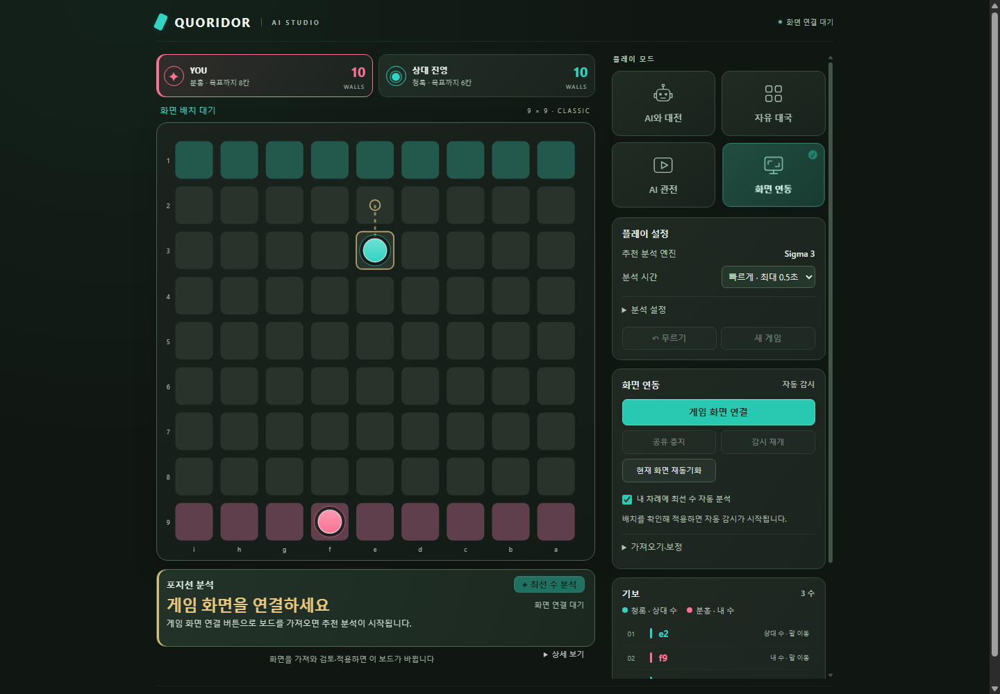

# Quoridor AI Studio

쿼리도 대전·관전·기보 복기를 지원하고, 추천 수의 효과를 쉬운 문장으로 설명하는 웹 앱입니다. 화면 공유를 통한 보드 인식과 동기화도 제공합니다.

[](https://darkflame265.github.io/12_quoridor_ai/)



## 브라우저 AI로 실행

Node.js 22 이상이 필요합니다. Python이나 AI 서버는 필요하지 않습니다.

```sh
npm ci
npm run dev
```

터미널에 표시되는 주소로 접속합니다. 첫 분석에서 ONNX 모델을 준비하며, 이후 방문자 PC의 Web Worker에서 WASM 추론과 PUCT 탐색을 수행합니다. 게임 상태나 화면 영상을 AI 서버로 전송하지 않습니다. 모델·런타임은 앱과 함께 제공하고 외부 CDN에 의존하지 않습니다.

정적 파일 만들기:

```sh
npm run build
npm run preview
```

GitHub 프로젝트 경로에서 사용할 빌드는 다음 명령으로 생성할 수 있습니다. **이 명령은 배포하거나 저장소 공개 상태를 바꾸지 않습니다.**

```sh
npm run build -- --base=/12_quoridor_ai/
```

완성 파일은 `dist/`입니다. Pages 설정과 실제 배포는 별도입니다.

## 기능

| 모드 | 사용 방법 |
|---|---|
| AI와 대전 | 이동 점·벽 미리보기로 조작하고 상대 엔진과 분석 엔진을 따로 선택 |
| 자유 대국 | 양쪽 말을 직접 조작하며 배치 검토 |
| AI 관전 | 두 AI의 대국을 자동 진행하거나 한 수씩 관찰 |
| 화면 연동 | 사용자 동의로 게임 탭 공유 후 격자·말·벽·진영을 인식하고 변경 반영 |

JSON 기보 저장·불러오기, 수 선택 시 자동 분석, 이전·다음 탐색, 추천 이유 설명을 지원합니다. 마지막 기보와 설정은 브라우저에 저장합니다. 첫 방문은 브라우저판에서 AI 대전, 로컬 Python판에서 화면 연동으로 시작합니다.

플레이어 카드에는 벽 10개를 막대로 표시합니다. 남은 벽은 진영 색, 사용한 벽은 흐린 윤곽으로 구분하고, 툴팁과 보조 기술에는 정확한 잔여 수를 제공합니다. 우측 상단 KR/EN으로 언어를 바꿀 수 있으며, 첫 방문은 브라우저 언어를 따르고 이후 선택을 저장합니다. 화면 언어 전환은 현재 기보·분석·화면 판독의 내부 값을 변경하지 않습니다.

플레이어 카드의 차례 문구는 내 차례·상대 차례·생각 중과 과거 기보의 차례를 구분합니다. 포지션 분석에는 이동·벽 추천 아이콘을 표시하고, 연결·분석 상태 배지는 대기·진행·완료·오류를 같은 형태로 안내합니다. 상태에 따라 카드와 보드 높이가 변하지 않도록 고정 공간을 사용합니다.

AI와 대전의 ‘내 차례에 최선 수 자동 분석’을 켜면 내 선공 시작과 상대 응수 후에 추천을 표시합니다. 기본값은 꺼짐이며 선택은 저장됩니다. 분석 중에도 직접 수를 둘 수 있고 이전 계산은 취소됩니다. 화면 연동의 자동 분석 설정과는 별개입니다.

화면 공유는 HTTPS 또는 localhost에서 지원되는 데스크톱 브라우저가 필요합니다. 브라우저의 탭 선택 절차를 자동으로 우회하지 않습니다. 모바일에서 화면 공유가 지원되지 않아도 보드 대전과 기보 기능은 사용할 수 있습니다.

## Web 엔진과 로컬 엔진의 차이

두 실행 방식은 같은 `best.onnx` 모델을 사용합니다. **Web 버전은 Python 엔진의 완전한 이식이나 동일 실력의 검증 결과가 아닙니다.**

| 실행 방식 | 계산 구성 |
|---|---|
| Web | JavaScript 게임 상태·벽 판정, ONNX Runtime Web, 최대 200회 PUCT, 반복 감지·즉시 도착 확인 |
| 로컬 | 기존 Python Sigma 2·3·4, 추가 전술 검토·캐시·각 버전의 후처리 |

Web UI는 엔진 이름에 `Web`을 표시합니다. Web 2는 방문 횟수 기반 선택, Web 3는 비슷하게 검토된 후보 중 이동 선호, Web 4는 비슷하게 검토된 후보의 가치·방문 횟수를 비교합니다. 기존 Python Sigma 3의 전체 전술 검토나 Sigma 4 weighted V3를 그대로 실행한다고 표현하지 않습니다. 과거 Python 승률 보고서를 Web 엔진의 성적으로 사용하지 않습니다.

모델 초기 준비는 생각 시간과 별개입니다. 0.5초·2초는 준비 후 탐색의 목표 예산이며, 느린 기기에서는 진행 중인 단일 추론·상태 평가를 마무리하는 시간 때문에 초과할 수 있습니다. Web 버전은 GitHub Pages에서 별도 보안 헤더 없이 실행할 수 있도록 단일 WASM 스레드를 사용합니다. GPU 사용과 다중 코어 가속을 보장하지 않습니다.

## 소스 구조

```text
src/
  game/       규칙·좌표·벽 사용 이력
  ai/         브라우저 탐색·추론·로컬 엔진 연결·분석 제어
  capture/    격자·말·벽 인식과 화면 동기화
  history/    기보·설정·판단 기록
  ui/         앱 구성·모드 선택·추천 설명
  styles/     스타일
  i18n/       한국어·영어 메시지와 화면 번역
server/       로컬 Python 엔진 API (정적 배포에는 불필요)
scripts/
  runtime/    로컬 Python 엔진과 정책
  qa/         브라우저·로컬 통합 검증
tests/
  unit/       단위 테스트
  fixtures/   검증에 필요한 배치·화면·Python 비교 자료
vendor/       외부 모델·기반 코드·라이선스
docs/         구조·검증·기여 범위
```

`public/models`와 `public/runtime`은 빌드 준비 시 생성됩니다. `node_modules`, `dist`, `.local-app`, `reports`와 생성 자산은 Git에서 제외하며, VS Code 탐색기에서도 숨깁니다. 과거 실험 자료 정리 내역은 [정리 기록](docs/CLEANUP.md)을 참고하세요.

## 기존 로컬 Python판

```sh
python -m pip install -r requirements.txt
npm run play
```

주소는 `http://127.0.0.1:12324/`입니다. 실행기는 정상 실행을 재사용하고 변경 시 재시작합니다. `npm run play:stop`으로 종료하고, Windows 바로가기는 `npm run play:shortcuts`로 설치합니다. 원래 개발 흐름은 `npm run dev:native`, 로컬용 빌드는 `npm run build:native`입니다.

## 검증

```sh
npm test
npm run browser:qa
npm run screen:qa
npm run sigma:smoke
```

- `browser:qa`: 실제 ONNX/WASM 추론, Python 출력과 비교, 프로젝트 하위 경로, AI 응수·추천, 서버 API 호출 없음 검증
- `screen:qa`: 가상 캡처·테스트 엔진으로 인식·동기화·기보·모드·모바일 UI 검증
- `sigma:smoke`: 기존 Python 3개 엔진의 실제 합법 수 검증 (Python 필요)

브라우저 QA는 Chrome 또는 Edge를 사용하며 개인 프로필을 열지 않습니다. 결과는 `reports/`에 생성합니다. 배포·저장소 공개 전환은 검증 명령에 포함되지 않습니다.

## 기반 모델 및 출처

[SigmaQuoridor](https://github.com/bartolomeo3000/SigmaQuoridor) — Bartosz Pokora ([bartolomeo3000](https://github.com/bartolomeo3000))

SigmaQuoridor의 사전 학습 ONNX 모델과 게임·MCTS 기반 코드를 활용했습니다. 이 프로젝트에서는 브라우저 실행, UI, 화면 인식·동기화, 기보 복기와 추천 이유 설명을 구현·통합했습니다.

원본의 [MIT 라이선스](vendor/sigma-quoridor/LICENSE)와 저작권 고지를 보존합니다. 기반 모델을 직접 학습한 프로젝트로 소개하지 않으며, 원본 엔진의 성능을 이 프로젝트 Web 버전의 성능으로 주장하지 않습니다.

## 기여와 라이선스

신경망을 처음부터 학습한 프로젝트가 아닙니다. 외부 SigmaQuoridor 모델·게임/MCTS 기반 위에 UI, 화면 인식·동기화, 엔진 통합, 시간 예산·취소·기보·추천 설명과 브라우저 실행을 구현했습니다. [외부 구성 요소](docs/THIRD_PARTY.md), [브라우저 구조](docs/ARCHITECTURE.md), [포트폴리오 가이드](docs/PORTFOLIO.md)를 참고하세요.
