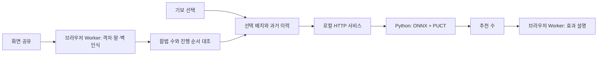

# Quoridor AI Studio

**게임 화면을 읽고, 다음 수의 효과를 설명하는 쿼리도 분석 도구입니다.**

외부 보드를 매번 수동으로 옮기는 불편을 줄이고, 추천 수를 기보와 함께 검토하는 개인 프로젝트입니다. 화면 인식, 합법 진행 복원, 시간 제한 AI 추론, 기보 분석을 하나의 작업 흐름으로 연결했습니다.


## 플레이 모드

플레이 설정 위의 2×2 카드에서 AI와 대전, 자유 대국, AI 관전, 화면 연동을 선택합니다. 처음에는 화면 연동으로 시작하며 이후에는 개인 기보와 마지막 설정을 복원합니다. 예제 체험 기능은 제거했습니다.

## 로컬 앱 실행

검증 환경은 Node.js 24와 Python 3.14입니다. Node.js 22 이상과 Python 패키지가 필요합니다.

```powershell
npm ci
python -m pip install -r requirements.txt
npm run play
```

주소는 **http://127.0.0.1:12324/**로 고정됩니다. 정상 실행은 재사용하고, 소스가 바뀌면 실행기가 새 빌드로 준비합니다. 바탕화면 `Quoridor AI` 바로가기도 같은 실행기를 사용합니다.

```powershell
npm run play:stop       # 실행 중인 앱 종료
npm run play:shortcuts  # Windows 바로가기 설치
```

## 주요 기능

| 흐름 | 동작 |
|---|---|
| AI와 대전 | 이동 가능한 칸 표시, 벽 미리보기, 상대 엔진 선택 |
| 기보 분석 | JSON 저장·불러오기, 수 선택 시 자동 분석, 이전·다음 이동 |
| 화면 연동 | 게임 탭 공유 → 격자·말·벽·진영 인식 → 합법 진행 자동 반영 |
| AI 관전 | 두 엔진의 대국을 일시정지·한 수 진행으로 확인 |
| 추천 설명 | 확인된 경로 증가·전진·방어 효과를 쉬운 문장으로 표시 |

‘게임 화면 연결’은 Wallz 화면에 맞춘 자동 연결 흐름입니다. 공유 탭 선택은 브라우저가 직접 받습니다. 정상 판독이면 자동 적용·감시를 시작하고, 수동 이미지 가져오기와 보정은 보조 메뉴에서 사용할 수 있습니다. 영상은 브라우저에서 처리하며 엔진에는 인식한 게임 상태를 전달합니다.

포지션 분석은 **보드 아래 고정 크기 영역**에 표시합니다. 긴 근거는 상세 보기에서 확인하고, 상태 문구가 바뀌어도 보드가 움직이지 않습니다.

## 기술 구성과 개선



- **갱신 지연:** 말이 움직여도 차례 문구나 기보 숫자가 늦으면 반영이 막혔습니다. 보드의 합법 변화와 차례 확인을 분리해, 내 수부터 반영하고 불확실한 추천만 보류하도록 개선했습니다.
- **취소 후 계산 밀림:** 요청만 취소하고 Python 계산은 계속하던 경로를 수정했습니다. 계산 중에도 취소를 받고, 최신 요청만 남깁니다.
- **응답 예산:** 선택한 시간을 탐색 내부에 적용합니다. 완료한 탐색 단위와 검토 결과를 사용하며, 최대 200회 이전에 종료될 수 있습니다. OS 스케줄링과 단일 연산 때문에 엄격한 실시간 상한을 보장하지는 않습니다.
- **재사용:** 정확히 같은 신경망 입력을 캐시하고, 합법 벽 판정을 비트셋으로 최적화했습니다. 기보 분석은 배치·과거 이력·엔진·시간 설정이 같은 결과만 재사용합니다.
- **설명 신뢰성:** 현재 배치의 경로 변화와 실제로 비교한 상대 벽을 설명합니다. ‘가두려는 의도’나 확정되지 않은 승리를 지어내지 않습니다.

응답 시간 기본 옵션은 ‘빠르게 · 최대 0.5초’와 ‘자동 · 최대 2초’입니다. 탐색은 조기에 완료될 수 있습니다. 계산에 연결되지 않았던 코어 선택은 UI에서 제거했고, 엔진 변경과 빌드 정보는 분석 설정에 모았습니다.

## 엔진과 기여 범위

AI와 대전에서는 **상대 AI 엔진·생각 시간**과 **추천 분석 엔진·분석 시간**을 따로 설정합니다. 예를 들어 Sigma 2를 상대로 두면서 Sigma 4의 추천을 볼 수 있습니다. 상대 카드는 실제 대전 엔진을 표시하고, 과거 기보·화면 연동은 추천 분석 설정을 사용합니다. 두 역할의 선택은 각각 기보 파일과 개인 세션에 저장됩니다. 예전 공통 설정만 있는 파일은 그 값을 두 역할의 초기값으로 가져옵니다.

- **Sigma 2:** 기준 PUCT 정책과 반복 방지 검토.
- **Sigma 3:** 공통 신경망에 전술·경로 검토를 추가한 정책.
- **Sigma 4:** 현재 배포는 기존 weighted V3 루트 선택을 사용하는 정책입니다. 빠른 벽 판정과 입력 캐시를 함께 사용합니다.

세 엔진은 외부 ONNX 모델 `vendor/sigma-quoridor/models/best.onnx`와 Python 게임·MCTS 기반을 공유합니다. **이 프로젝트에서 신경망을 처음부터 학습했다고 주장하지 않습니다.** 앱 UI, 화면 인식·동기화, 로컬 서비스 통합, 취소·시간 예산, 분석 캐시, 기보 흐름과 설명 기능을 구현·개선했습니다. 기반 게임·MCTS와 모델 사용 범위는 [외부 구성 요소](docs/THIRD_PARTY.md)에 정리했습니다.

현재 추론은 CPU의 ONNX Runtime입니다. GPU나 Rust 도구는 실행에 필요하지 않습니다. Sigma 4의 전체 승률 우위나 사람에 대한 무패를 보장하지 않습니다. Sigma1·Atlas 기보의 수는 읽을 수 있지만 삭제된 엔진으로 재계산하지는 않습니다.

최근 0.5초 조건의 72판 비교에서는 Sigma 2가 27승 20패 1회 반복 종료, Sigma 3가 24승 23패 1회, Sigma 4가 19승 27패 2회였습니다. 이번 표본의 성적은 Sigma 2가 가장 높았지만, 배치별 선후공 비교에서 명확한 최약 삭제 기준을 충족한 엔진은 없었습니다. 세 엔진과 개인 설정은 유지합니다. [비교 조건·전체 집계·한계](docs/SIGMA_ENGINE_COMPARISON_20261106.md)를 확인할 수 있습니다.

## 검증과 재현

```powershell
npm test                          # 규칙·인식·세션·설명 검증
npm run screen:qa                 # 격리 브라우저의 실제 UI 흐름
npm run sigma:smoke               # 실제 세 엔진의 합법 추천
node scripts/check-sigma-latency.mjs
python scripts/check_sigma_fast_walls.py
```

화면 QA는 독립적으로 그린 가상 게임 화면과 테스트 엔진 응답을 사용합니다. 실사용 사이트 전체를 자동 검증했다는 뜻은 아닙니다. 모드 카드 선택·키보드 조작·모션 감소 설정과 개인 데이터 복원을 확인합니다.

2026-11-06 로컬 개선 검증에서는 다음을 확인했습니다.

- 5회 연속 취소 후 최신 추천까지 약 0.25 / 0.35 / 0.28초(Sigma 2 / 3 / 4).
- 실제 앱의 0.5초 요청 응답 약 0.48 / 0.49 / 0.50초. 초기 모델 로딩·화면 인식 시간은 별도입니다.
- 빠른 벽 판정은 263개 도달 가능한 배치에서 기존 합법 수와 순서가 일치했습니다.
- 고정 200회 탐색의 초반·중반·후반 9개 비교에서 기존 추천이 유지됐습니다.

위 수치는 해당 PC의 작은 표본이며 승률 검증 결과가 아닙니다. [시연 순서와 증거 위치](docs/PORTFOLIO.md)를 함께 제공합니다.

