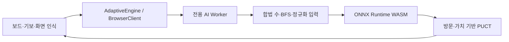

# 실행 구조

## 브라우저판

`VITE_BROWSER_AI=1` 빌드에서는 HTTP AI API를 만들거나 호출하지 않습니다. 앱과 함께 배포된 모델을 내려받고 단일 스레드 WASM으로 추론합니다. 서로 다른 엔진 클라이언트는 하나의 Worker와 모델 세션을 공유하고 요청을 순서대로 처리합니다. 취소된 요청은 응답을 버리고, 탐색 중에도 주기적으로 이벤트 루프에 제어를 돌려줍니다.

입력은 현재 플레이어 관점의 8×9×9 텐서이고, 정책 출력 136개와 가치 출력 1개를 사용합니다. 양쪽 차례·벽·점프 배치에서 Python 입력 및 정책 인덱스·합법 수가 같은지 검증합니다. 실제 WASM 정책·가치는 Python ONNX 출력과 허용 오차 내에서 비교합니다.

추론 캐시는 최대 1,024개, 탐색은 최대 200회로 제한합니다. 반복 배치는 중립값으로 처리하고 즉시 목표 도착 수를 우선합니다. Web 2/3/4의 후보 선택은 코드와 README에 명시하며, Python판의 모든 전술 후처리를 이식했다고 주장하지 않습니다.

모델 초기화는 탐색 예산에서 제외합니다. 웹 다운로드·초기화 실패는 사용자에게 알리고, 준비·요청에 무한 대기가 생기지 않도록 제한합니다. 느린 기기에서 단일 추론이 예산을 넘길 수 있어 0.5초 벽시계 보장은 하지 않습니다.

## 로컬판

`npm run play`는 기존 고정 포트 실행기와 Python 서버를 사용합니다. 게임 규칙/UI는 공유하지만 추론은 `server`와 `scripts/runtime`에서 수행합니다. 로컬 사용자에게 기존 엔진을 보존하기 위한 경로이며 정적 사이트 실행에는 필요하지 않습니다.

## 배포 준비와 범위

`npm run build -- --base=/12_quoridor_ai/`는 정적 산출물만 생성합니다. 프로젝트 하위 경로에서도 Worker·WASM·모델 주소가 같은 경로 아래에서 로드됩니다. 저장소 공개 전환, Pages 설정, 포트폴리오 수정은 이 작업 범위에 포함하지 않습니다.
