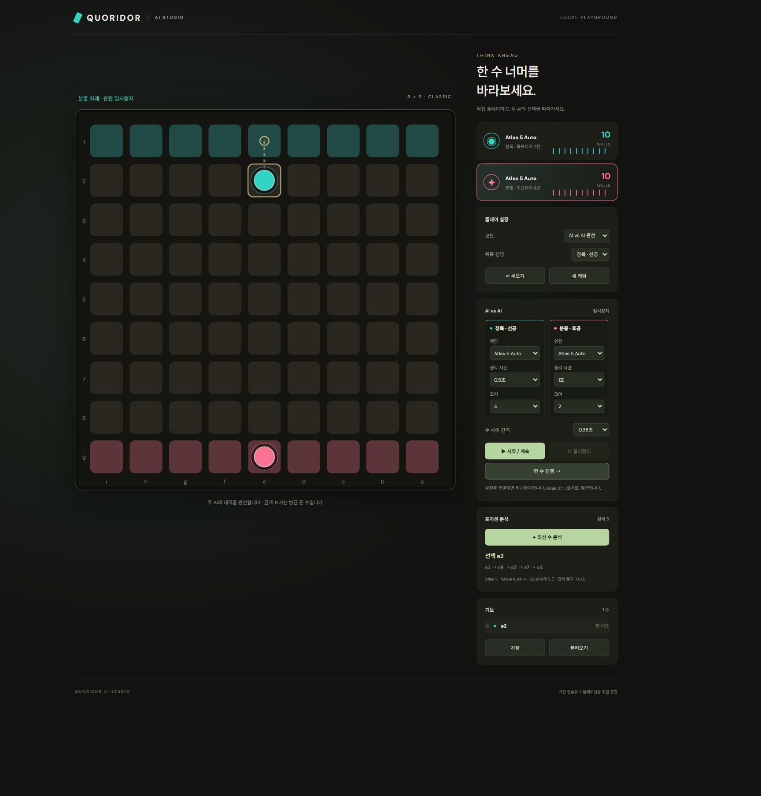

# Atlas 5: 짧은 시간의 네이티브 공유 탐색

2026-10-27. 이번 변경은 계산 효율과 실행 구조를 개선합니다. 초인적 실력이나 일반 국면의 최적 수를 보장하지 않습니다. 동일 시간 대국에서 확실한 실력 향상은 아직 입증하지 못했습니다.

## 변경

- 독립 `native-engine` 크레이트가 기존 Rust 규칙을 포함하고 네이티브 검색을 추가합니다. 기존 WASM과 Atlas 3 비교 엔진은 그대로 보존했습니다.
- 프로세스를 유지해 수마다 시작 비용을 내지 않습니다. 1~4개 CPU 코어가 루트 작업을 동적으로 나누고, 64개 조각으로 나눈 전이표·평가·합법 수 정렬 캐시를 공유합니다.
- 좌우 대칭 배치와 행동을 정규화합니다. 전이표 점수 경계는 반복 경로 문맥까지 일치할 때 사용합니다. 깊이가 다른 분할의 점수를 섞지 않습니다.
- 양쪽 벽이 없는 종반은 고정 미로 역산으로 정확히 풉니다. 계산 취소와 이후 검색은 같은 프로세스에서 처리합니다.
- 브라우저의 Atlas 5 Auto는 네이티브 우선, 연결 실패 시 기존 WASM으로 복귀합니다. Atlas 4/3 선택도 남겼습니다. 일반 플레이와 관전에 모두 연결했습니다.
- 서버는 `127.0.0.1:4317`에만 바인딩하고 Vite 프록시를 이용합니다. 로컬 Host/Origin과 입력 크기·범위를 검사합니다. 다른 페이지 세션이 사용 중이면 409를 반환해 WASM으로 복귀합니다. 배포된 정적 사이트에서는 네이티브 서비스가 자동 제공되지 않습니다.

## 0.5초 측정

같은 6개 검증 배치, 같은 500ms, 기존 WASM Worker 풀과 새 네이티브 프로세스를 비교했습니다. 각 코어 조건에서 프로세스를 시작한 뒤 health 응답으로 준비를 마쳤습니다. 보고서에 시작 시간도 별도로 기록했습니다. 측정값은 이 PC에서의 소규모 표본이며, p95는 6개 중 최댓값입니다. 노드 비용과 선택적 축소가 달라 깊이만으로 실력을 판정할 수 없습니다.

| 코어 | 기존 평균 완료 깊이 | 새 평균 완료 깊이 | 기존 응답 p95 | 새 응답 p95 |
|---|---:|---:|---:|---:|
| 1 | 3.17 | 3.17 | 553.3ms | 501.0ms |
| 2 | 3.17 | 3.50 | 551.2ms | 500.9ms |
| 4 | 3.33 | 4.17 | 557.9ms | 500.9ms |

원자료: [기존](fast-engine/baseline.json), [네이티브 및 소스 해시](fast-engine/native-profile.json). 기존 결과에는 Worker 기동·WASM 준비가 포함되고, 네이티브는 health 준비 이후입니다. 따라서 응답 시간 차이를 순수 검색 속도 배수로 해석하면 안 됩니다.

미사용 평가 배치 4개에서 진영을 바꾼 8판, 양쪽 500ms·4코어: **4승 4패 0무**. 표준·이동 배치 3승 1패, 벽 미로 1승 3패였습니다. 모든 수를 독립 JS 규칙으로 검사했습니다. 이 결과는 강해졌다는 증거가 아니며 벽 미로의 전략 평가가 다음 병목입니다. 실행 중 앞부분 일부는 GPU 학습·테스트와 겹쳤으므로 엄밀한 통제 대국도 아닙니다. [전체 기보](fast-engine/native-match.json).

재현:

```powershell
npm run native:build
node scripts/latency-baseline.mjs
node scripts/native-profile.mjs
node scripts/native-match.mjs
```

## GPU 준비와 실제 범위

RTX 3060 Ti 8GB에서 별도 `.venv-gpu`에 PyTorch 2.11.0+cu128을 설치했습니다. 전역 CPU Python은 바꾸지 않았습니다. CUDA 행렬 계산, 기존 정책/가치망의 CPU/GPU 수치 일치, 역전파와 가중치 갱신을 확인했습니다.

현재 128폭 MLP는 배치 1에서 CPU 약 0.049ms, CUDA 약 0.163ms였고, 배치 256에서는 CPU 약 0.293ms, CUDA 약 0.182ms였습니다. 작은 망을 한 번씩 호출하는 게임 탐색에 GPU를 붙이는 것만으로 빨라지지 않습니다. [측정](fast-engine/gpu-profile.json).

기존 체크포인트에서 CUDA 자가대국 2판·학습 1회를 재개해 완료했습니다. 비교 대국 1승 1패이며 승격 기준을 통과하지 못했습니다. **실전 신경망은 활성화하지 않았습니다.** 기존 학습의 상대 엔진은 Atlas 4 WASM입니다. 이 짧은 실행은 GPU 파이프라인 검증이며 충분한 강화학습이 아닙니다. CUDA 난수 상태도 체크포인트에 저장·복원하도록 고쳤습니다. [학습 기록](fast-engine/gpu-training.json).

```powershell
python -m venv .venv-gpu
& .\.venv-gpu\Scripts\python.exe -m pip install -r training/requirements-gpu.txt
& .\.venv-gpu\Scripts\python.exe training/gpu_profile.py
& .\.venv-gpu\Scripts\python.exe training/train.py --out training/runs/gpu-smoke --resume models/bootstrap-checkpoint.pt --iterations 1 --games 2 --simulations 12 --epochs 2 --arena-pairs 1 --arena-ms 50 --max-plies 180
```

다음 실력 개선은 패배한 미로 기보에서 평가 오차를 고치고, 그 뒤 더 큰 정책/가치망·여러 자가대국의 배치 추론·충분한 학습을 통제 평가하는 순서입니다. 이번 변경에는 CNN, 대규모 GPU 자가대국, GPU 배치 MCTS, 초인적 모델이 포함되지 않습니다.

## 검증

- Node 57개, 네이티브 Rust 7개, Python 3개 테스트 통과. Vite 프로덕션 빌드 통과.
- 즉시 승리·방어·점프 등 16개 전술 배치, 취소 후 같은 프로세스 재사용, 로컬 HTTP/스트리밍, 연결 실패 시 WASM 복귀와 늦은 결과 차단을 확인했습니다.
- 실제 Chrome에서 500ms·4코어의 일반 분석과 관전 한 수 진행이 `Atlas 5 · Native Rust ×4`로 동작하는 것을 확인했습니다.


